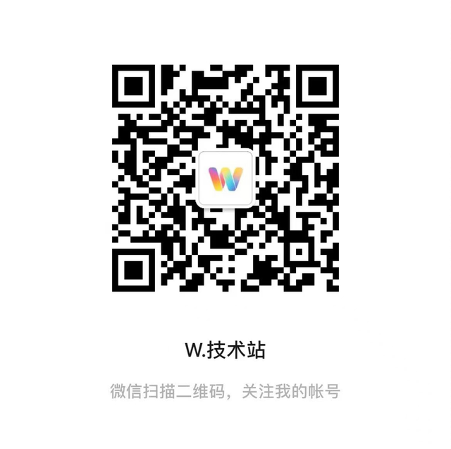

# WBOX

安卓电视盒子 / 智能电视上的影视聚合客户端，原生 Kotlin + Jetpack Compose 实现，专为遥控器操作设计。

适配 Android 5.0 及以上；手机、平板也能装，手机上自动切换竖屏触屏界面，横过来自动全屏。

**当前版本：v3.0.33（2026-11-28）** · [前往下载](https://github.com/wgsjjj/LibreTV-AndroidTV/releases/tag/v3.0.33)

## 功能一览

| 模块 | 能做些什么 |
|---|---|
| 🎬 点播 | 电影 / 电视剧 / 动漫 / 综艺；豆瓣热榜与四大分类、标签筛选、多源聚合搜索、拼音首字母联想、收藏、播放历史续播、相关剧集（其他季） |
| ⚡ 详情页 | 落盘缓存 + 三路并发解析，同一部片二次进入零请求；多源测速按延迟排序自动选最快源 |
| ▶️ 播放 | 硬解优先、失败回退软解；倍速、画面比例、网速角标、跳过片头片尾、FFmpeg 补 MP2 / AC-3 音轨；点播缓冲最小 30 秒、最大 10 分钟 |
| ⏩ 连发快进 | 遥控器长按 ← → 连续拖动进度，画面跟着走并弹中央大字提示；手机点播页长按左半屏快退 / 右半屏快进，越按越快 |
| 📡 协议 | HTTP / HLS / RTSP（UDP 失败切 TCP）/ RTP 与 UDP 组播（自实现数据源）/ RTMP；直播源可直接填单路地址 |
| 📺 直播 | m3u / txt 源、频道分组、同台多线路归并、超时自动换线并记住可用线路、信号强度柱、频道测速、台标多源轮询、EPG 节目单 |
| 🔌 TVBox 规则 | 内置 catvod 运行时，可直接加载 .jar / .dex 形态的站点规则；订阅管理、分组并发搜索、独立详情页、网页嗅探 m3u8、播放地址短时缓存、多镜像探测自动选可用 |
| 📲 手机端 | 同一个包装手机上自动切竖屏界面；一体化直播页、磨砂浮层、手势调亮度音量、点播页长按左右半屏快退快进、横竖屏自动切换；直播源 / 点播源可导入本地文件 |
| 📱 手机推送 | 电视出二维码，手机网页端管理源、改家长控制 PIN、配台标与节目单、推影片到电视，不用装手机 App |
| 📺 投屏 | DLNA / UPnP 设备发现与媒体中继 |
| 👪 家长控制 | PIN 锁、可用时长、退出即上锁、扫码设置 |
| ⚙️ 其他 | 开机自启与启动页选择、遥控器按键自定义、公告条、崩溃恢复、调试日志与导出、横屏锁定与电视 Launcher 入口、正式签名 |

## 下载与安装

**当前版本：[v3.0.33](https://github.com/wgsjjj/LibreTV-AndroidTV/releases/tag/v3.0.33)**，发布于 2026-11-28。

在 [Releases](https://github.com/wgsjjj/LibreTV-AndroidTV/releases) 页面下载 `WBOX-v3.0.33.apk`，或直接点：
[下载 v3.0.33](https://github.com/wgsjjj/LibreTV-AndroidTV/releases/download/v3.0.33/WBOX-v3.0.33.apk)。

拷贝到 U 盘插到电视上安装，或用 adb 安装：

```
adb install WBOX-v3.0.33.apk
```

- 版本：`3.0.33`（versionCode `363`），约 30 MB，Android 5.0 及以上，`arm64-v8a` / `armeabi-v7a`
- 签名 SHA-256：`9281b7a7d3b6f4cd23e86e2edc4fc1a37bf6b6449e609247650068a83471279b`
- 文件 SHA-256：`9a0f35795d9ea37516853a128b22696bd3a2b6b34c5b20ca57bee2e43d05b2ba`

> **⚠️ 从 v3.0.33 起换成了新的正式签名证书**：与之前所有版本的签名都不一致，**升级前必须先卸载旧版**。
> 卸载会清掉已添加的源与收藏，装好后重新添加即可。之后各版本签名保持稳定，可以直接覆盖安装。

---

## 关于节目源

安装后默认是空的，需要你自己添加源才能使用。App 本身只是一套播放器与搜索工具——你给它什么源，它就去哪里找内容，仅此而已。

### 找不到源？

如果手上没有可用的源，**可以关注下面的公众号获取**。

作者从公开网络上整理了一批目前还能用的直播源和点播源，放在公众号里，回复关键词即可领取。

> 以下接口地址均通过网络公开检索整理，仅作技术测试与学习用途，不保证可用性，也不对第三方内容作任何担保。如有侵权，请联系删除，核实后会第一时间处理。

<p align="center">
  
</p>

<p align="center">长按识别 / 扫码关注，在公众号内回复关键词获取</p>

---

## 免责声明

使用本软件前请仔细阅读以下内容，**下载、安装或使用即表示你已理解并同意**：

1. **App 本身仅为技术工具。** 它不内置、不存储、不托管、不分发、不上传任何音视频文件。播放内容均来自用户自行添加的第三方接口，与本 App 无关。

2. **本软件不具备内容生产能力。** 它只负责解析用户给定的接口并播放，不生产、不编辑、不审核任何影视资源。

3. **合法使用。** 使用者应确保自己对所访问的内容拥有合法权限，并遵守所在国家或地区的法律法规。**不得将本软件用于任何侵犯著作权、传播违法信息或其他违法用途。**

4. **责任自负。** 因使用或无法使用本软件而产生的任何直接或间接损失、法律责任、纠纷，均由使用者自行承担，作者不承担任何责任。

5. **第三方接口风险。** 用户添加的第三方接口由第三方提供，其内容、可用性、安全性均不受本软件控制。作者不对任何第三方接口的内容负责，也不对其合法性作任何保证。

6. **按现状提供。** 本软件按「现状」提供，不附带任何明示或暗示的担保，包括但不限于适销性、特定用途适用性、无侵权担保。

7. **权利主张。** 若你认为本软件或本仓库的某项内容侵犯了你的合法权益，请通过公众号留言联系，核实后会尽快处理。

8. **保留权利。** 作者保留随时修改、停止分发本软件或本说明的权利。

---

<p align="center">
  <sub>本仓库仅用于版本发布与说明 · App 本身不内置任何节目源</sub>
</p>